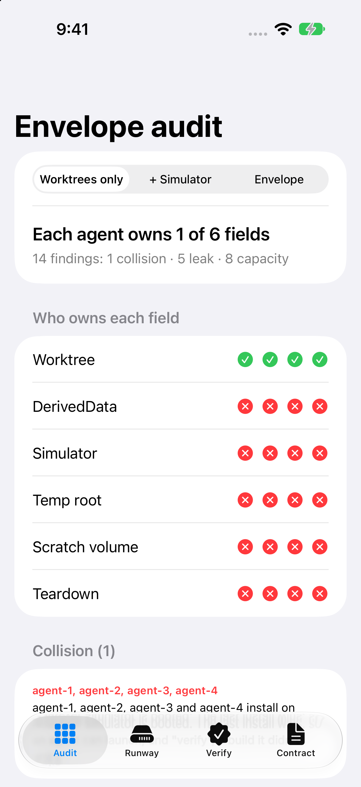
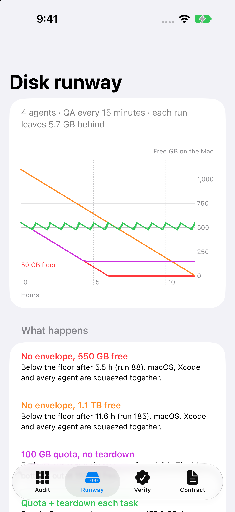
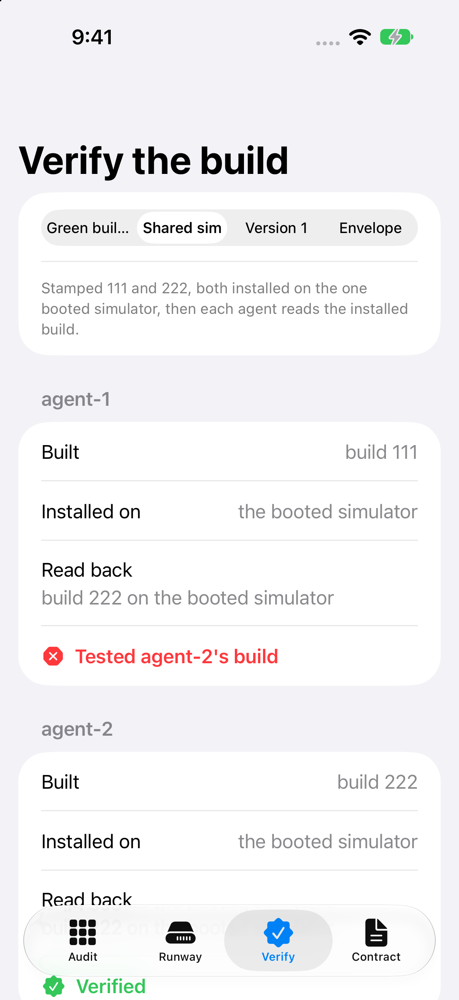

# AgentEnvelope

**Execution envelopes for parallel coding agents on one Mac.** A git worktree keeps each agent's code apart. It doesn't give an agent its own Simulator, temp folder, disk budget or teardown. This Swift package writes down the six things each agent should own, audits a set of agents against a shared Mac, models how fast a leaky QA script eats the disk, and checks that an agent verified the build it actually made.

Article: (added after publish)

<p align="center">
  
  
  
</p>

Real screenshots of the demo app running in the iOS Simulator (iPhone 18 Pro, iOS 27.2), taken by `Scripts/simulator-screenshots.sh`.

## The six fields

An agent **owns** a field when no other agent can write to it and nothing the agent leaves in it outlives the task. It owns **Teardown** when nothing it writes outlives the task: no field falls back to a shared default like `$TMPDIR` or Xcode's DerivedData, and the harness deletes the rest.

| Field | What an agent uses if you don't set it | What the envelope gives it |
|---|---|---|
| Worktree | the shared checkout | its own `git worktree` |
| DerivedData | Xcode's default folder, outside the worktree, which outlives it | a path inside the envelope |
| Simulator | whichever simulator is already booted | a simulator of its own, UDID in every command |
| Temp root | the user's shared `$TMPDIR` | `TMPDIR` inside the envelope |
| Scratch volume | the Data volume: no cap, inside Time Machine's local snapshots | its own APFS volume with a quota, excluded from Time Machine |
| Teardown | nothing is deleted | the harness deletes all of the above, whatever state it's in |

On the constructed four-agent Mac in `Sample`:

| Setup | Owned per agent | Findings |
|---|---|---|
| Worktrees only | 1 of 6 | 14 (1 collision, 5 leak, 8 capacity) |
| Worktree + DerivedData inside it + a simulator per agent, deleted at teardown | 3 of 6 | 9 (1 leak, 8 capacity) |
| The same, but the cloned simulators are kept | 2 of 6 | 13 |
| Full envelope | 6 of 6 | 0 |

## What's in it

- `ExecutionEnvelope`, `EnvelopePath`: the six fields as a value. Paths compare by component, so `/Volumes/agent-1` never "contains" `/Volumes/agent-10`.
- `EnvelopeAudit`: collisions (a shared checkout or simulator, overlapping paths, a simulator "UDID" that isn't a UUID, deleting a volume other agents use), leaks (default DerivedData, a shared temp root, anything teardown misses, including the volume itself) and capacity (no quota, Time Machine snapshots, pooled volumes, paths off the agent's volume, quotas that add up to more than the Mac can spare, too many simulators). A field counts as owned only when no finding takes it away, so every gap has a reason.
- `DiskRunway`: free space while agents leak a fixed amount per QA run, under four policies: nothing, a bigger disk, per-agent quotas, quotas plus teardown. A run that doesn't fit writes until its quota (or the disk) is full and then fails. `trace` has every run, so the dips inside each hour show. Inputs are clamped and a simulation stops after 100,000 runs, so nothing overflows.
- `CapacityPlan`: how many agents fit, the smaller of the simulator budget and headroom ÷ quota.
- `ProvenanceGate`: "verify against the artifact you built" as a check. A green build with no read-back is `notChecked`. A read-back that finds another agent's stamp is `foreignBuild`. Two agents with the same stamp on one simulator is `ambiguousStamp`. Your own build on a simulator other agents installed to is `sharedSimulator`, because reinstalling keeps app data. Only `verified` counts. UDIDs compare case-insensitively, as `simctl` treats them.
- `EnvelopeContract`: renders the AGENTS.md section and the harness teardown from the same envelope the audit checks. It refuses to render while any field the agent needs is unset. It only emits `rm -rf` for a path strictly inside the agent's own volume or an agents root you name (`~/agents`, say), never for one that overlaps the repo, and refuses everything else however it's spelled or capitalised. It shuts a simulator down before deleting it, and refuses `simctl delete` for anything that isn't a UUID.

```swift
import AgentEnvelope

let agent2 = ExecutionEnvelope(
    agent: "agent-2",
    worktree: EnvelopePath("/Volumes/agent-2/worktree"),
    derivedData: EnvelopePath("/Volumes/agent-2/DerivedData"),
    simulator: .dedicated(udid: "22222222-2222-4222-8222-222222222222"),
    tempRoot: EnvelopePath("/Volumes/agent-2/tmp"),
    scratch: .dedicated(name: "agent-2", quotaBytes: Bytes.gb(100), inTimeMachine: false),
    teardown: .everything
)

let report = EnvelopeAudit.run(Sample.envelopes(.worktreesOnly), on: Sample.host)
report.ownedCount(for: "agent-1")   // 1
report.findings.count               // 14

let section = try EnvelopeContract.agentsSection(for: agent2, options: Sample.contractOptions)
let teardown = try EnvelopeContract.teardownCommands(for: agent2, repo: Sample.repo)
// xcrun simctl shutdown/delete '22222222-…', git … worktree remove --force …, diskutil apfs deleteVolume '/Volumes/agent-2'
```

```swift
let replay = Sample.replay(.sharedSimulator)          // stamped 111 and 222, one booted simulator
let verdicts = ProvenanceGate.verdicts(receipts: replay.receipts, checks: replay.checks)
verdicts["agent-1"]   // .foreignBuild(installedBy: "agent-2")
verdicts["agent-2"]   // .sharedSimulator(with: ["agent-1"])
```

## Setting up one envelope by hand

These are the commands the model stands for (macOS 27; check `man diskutil` and `man tmutil` on yours). `diskutil apfs list` shows your APFS container, which is often `disk3` on Apple silicon.

```sh
diskutil apfs addVolume disk3 APFS agent-2 -quota 100g    # a quota can only be set when the volume is created
sudo tmutil addexclusion -v /Volumes/agent-2               # volume exclusion: no Time Machine local snapshots
git -C ~/src/App worktree add -b agent-2 /Volumes/agent-2/worktree
mkdir -p /Volumes/agent-2/DerivedData /Volumes/agent-2/tmp
xcrun simctl create agent-2 "iPhone 18 Pro"                # prints the UDID that goes into the envelope
```

Check the new volume really mounted at `/Volumes/agent-2`: if a stale volume already had that name, macOS mounts the new one as `/Volumes/agent-2 1`, so keep the disk identifier `addVolume` prints (`diskutil info <id>` gives its volume UUID). Start the agent with `TMPDIR=/Volumes/agent-2/tmp`, and give it the AGENTS.md section `EnvelopeContract` renders. When the task ends, run the teardown it generates. Deleting the volume needs ownership of the disk. The **Contract** tab in the demo shows both.

## Run it

1. Clone this repo and open `Demo.xcodeproj`.
2. Pick the **Demo** scheme and any iOS 17 or later Simulator.
3. Build and run. The app consumes the package through a local package reference, so there's nothing else to set up.

Library only: `swift build` and `swift test`.

Screenshots from the command line: `bash Scripts/simulator-screenshots.sh` (from any directory). It creates a simulator of its own, builds for `generic/platform=iOS Simulator` into the repo's `build/`, passes a per-build `CURRENT_PROJECT_VERSION` and refuses to continue unless the installed app has that stamp. It points `TMPDIR` at a temp root, checks each launch is still running, and on exit deletes the simulator, `build/` and the temp root (`KEEP_SIM=1` and `KEEP_BUILD=1` keep them).

The article's runway chart is drawn from the model's own trace. `testRunwayTraceMatchesTheCommittedChartData` fails if `docs/runway-trace.json` drifts from the model; to regenerate it and the chart:

```sh
RUNWAY_TRACE_OUT=$PWD/docs/runway-trace.json swift test --filter testRunwayTraceMatchesTheCommittedChartData
python3 docs/make_runway_chart.py docs/runway-trace.json docs/runway.svg
```

## Verification status

- `swift build -Xswiftc -warnings-as-errors`: clean (macOS 27.2, Xcode 27.2, Swift 6.4.2).
- `swift test`: 59 tests, 0 failures.
- iOS Simulator: `Scripts/simulator-screenshots.sh` built the app with `xcodebuild`, installed and launched it on a newly created iPhone 18 Pro simulator (iOS 27.2), confirmed the installed CFBundleVersion matched the build's stamp, launched all five screens by launch argument, confirmed each was still running, took the screenshots in `Demo/Screenshots/`, then deleted the simulator. It used the command line only, with no taps.

## Notes and limits

- `Sample` is a constructed scenario. The 5.7 GB fixture and the 500-600 GB free-space buffer come from [Fatbobman's Swift Weekly #160](https://fatbobman.com/en/weekly/issue-160/). The run cadence (QA every 15 minutes), the task size (four runs), the 50 GB floor, the quotas and the UDIDs are made up.
- `DiskRunway` counts only what runs leave behind. It ignores Time Machine snapshot retention, which is why the envelope puts scratch data on a volume Time Machine doesn't snapshot.
- Paths under `~` and under `/Users/<you>` are compared as different roots. Write envelopes in one style.

## Credits

- Fatbobman, ["The Case of the Rapidly Disappearing Disk Space"](https://fatbobman.com/en/weekly/issue-160/), Fatbobman's Swift Weekly #160.
- Amarildo Lucas, ["How to Run Multiple Claude Code Agents on the Same Xcode Project"](https://flowdeck.studio/blog/run-multiple-claude-code-agents-xcode-project) (Flowdeck blog).
- Apple, [About Time Machine local snapshots on Mac](https://support.apple.com/guide/mac-help/about-time-machine-local-snapshots-mh35933/mac).
- Howard Oakley, [Planning complex Time Machine backups for efficiency](https://eclecticlight.co/2024/10/28/planning-complex-time-machine-backups-for-efficiency/) and [When to use a new container, volume or folder](https://eclecticlight.co/2026/09/21/when-to-use-a-new-container-volume-or-folder/).

MIT licensed.
